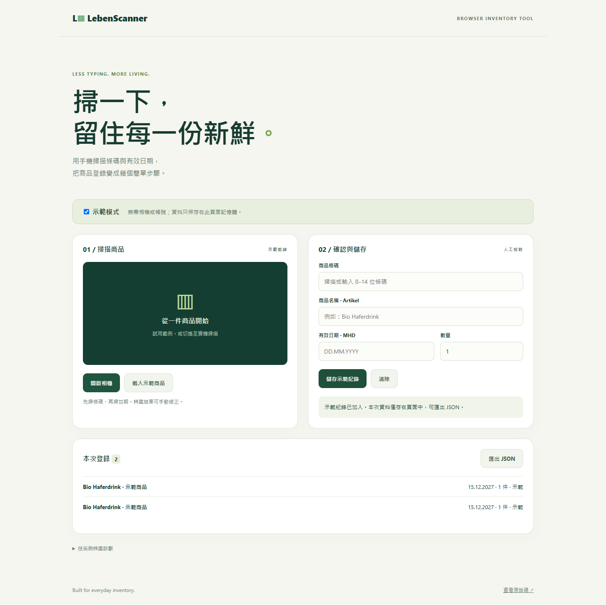

# LebenScanner

手機商品登錄工具：掃描條碼與有效日期，核對後儲存或匯出。



## 30 秒體驗

需要 Node.js 22 以上，不需要安裝依賴。

```sh
npm start
```

開啟 http://localhost:8000 →「載入示範商品」→「儲存示範紀錄」→「匯出 JSON」。預設示範模式不啟動相機、不載入 OCR 模型，也不傳送資料。紀錄只存在本次頁面記憶體，重新整理即清除。

## 解決的問題

商品登錄常要反覆輸入條碼、效期及數量。本專案把相機擷取、辨識、人工核對及登錄串成同一個瀏覽器流程，保留手動輸入作為辨識失敗時的替代方式。

## 技術與設計

- 原生 JavaScript ES modules，沒有建置程序。
- ZXing Browser 0.1.5 辨識商品條碼；PaddleOCR.js 0.4.2 辨識日期候選。
- ROI 裁切縮小辨識範圍；OCR 僅在實機模式開啟相機時載入。
- 支援 DD.MM.YYYY、YYYY-MM-DD 及八位數日月年；以完整曆法檢查閏年及月份天數。四位數年份原樣保留，不猜測或覆寫。
- 真實提交必須收到接收端 `{ok:true}` 才能顯示成功。
- DOM 文字輸出避免把商品名稱或診斷文字解讀成 HTML。

## 相機與雲端設定

1. 關閉示範模式，允許相機權限。手機部署需要 HTTPS，本機可用 localhost。
2. 先掃條碼，再掃效期。也可以手動輸入；條碼接受 8、12、13、14 位數字，這是格式檢查，未驗證 GTIN 檢查碼。
3. Google Apps Script 接收程式在 [apps-script/Code.gs](apps-script/Code.gs)。設定 Script property `SPREADSHEET_ID`，目標工作表第一列可設為 time、barcode、artikel、mhd、qty。
4. 部署為 Web App，以自己身分執行，將可存取的 /exec URL 填入 `js/google.js` 的 `SUBMIT_URL`。公開部署會允許持有網址者寫入，展示請使用專用試算表。
5. 接收端完成 appendRow 及 flush 後才回傳 `{ok:true}`。前端以 text/plain JSON 避免不必要的預檢，仍要求瀏覽器能讀取回應；若存取政策、重新導向或 CORS 阻擋，介面會顯示失敗而不宣稱寫入成功。

提交逾時可能發生在實際寫入後。重試前請查看試算表，以免重複登錄。目前未實作冪等提交。

## 驗證

```sh
npm test
```

測試涵蓋曆法日期、OCR 候選、年份保留及接收端確認。另以桌面與 390px 手機瀏覽器驗證示範登錄、無效日期、JSON 匯出按鈕狀態及未設定雲端服務的失敗提示。GitHub Actions 會執行單元測試。

相機實物掃描、模型下載及 Google Sheets 正式寫入仍需於目標手機與自己的部署環境驗證。本次沒有把外部服務或模擬測試當成實機成功紀錄。

## 作品集介紹

> 設計並實作瀏覽器商品登錄工具，整合相機 ROI 裁切、條碼辨識與 OCR 日期擷取，加入完整日期驗證、人工核對及可確認結果的提交介面，並提供免帳號示範模式與 JSON 匯出。

[手機版畫面](docs/mobile.png)
